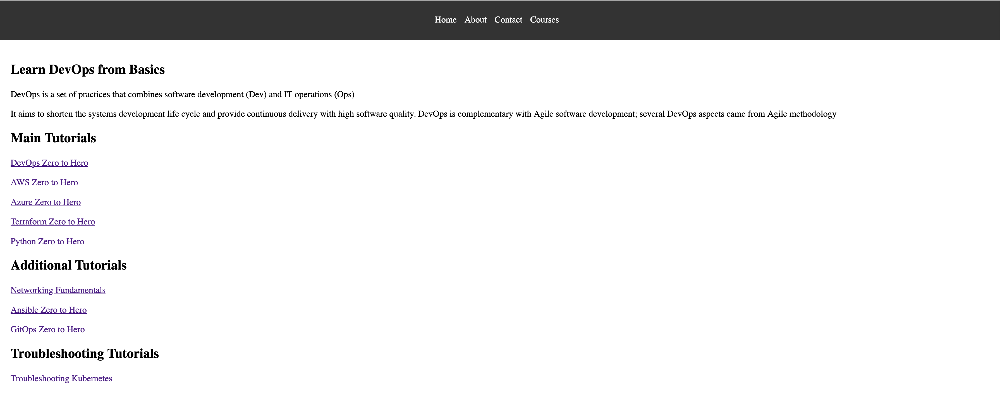

# go-web-app-cicd-k8s

A simple website written in Go, served with the standard library's `net/http` package — no web framework. The project exists as a vehicle for a complete DevOps delivery chain: containerization, CI/CD, Kubernetes, Helm and GitOps.



## Routes

| Path | Description |
|------|-------------|
| `/home` | Landing page |
| `/courses` | Courses listing |
| `/about` | About page |
| `/contact` | Contact page |

The server listens on `0.0.0.0:8080`.

## Running locally

```bash
go run .
```

Then open <http://localhost:8080/courses>.

> **Note on cgo** — if the build fails with `fatal error: stdlib.h: No such file or directory`, the C headers are missing on the machine. This application is pure Go and doesn't need cgo:
>
> ```bash
> CGO_ENABLED=0 go run .
> ```
>
> Alternatively install the toolchain with `sudo apt install -y build-essential`.

## Running on an EC2 instance

`localhost` refers to the instance itself, so from your own machine use the instance's public address:

```
http://<EC2-public-IP>:8080/courses
```

Port `8080` must be open in the instance's security group — add an inbound rule for Custom TCP, port `8080`, with your own IP as the source.

Since `go run` stops when the SSH session ends, run the container instead for anything longer-lived (see below).

## Docker

The image is built in two stages: the binary is compiled on `golang:1.21`, then copied into a `gcr.io/distroless/base` image, which carries no shell or package manager and keeps the final image small.

```bash
docker build -t go-web-app .
docker run -d -p 8080:8080 go-web-app
```

`CGO_ENABLED=0` is set at build time so the binary is statically linked — distroless has no C library to link against at runtime.

## Kubernetes

Raw manifests for a Deployment, Service and Ingress:

```bash
kubectl apply -f k8s/manifests/
```

The Ingress expects an NGINX ingress controller in the cluster — see [`ingress-controller/nginx/01-installation.md`](ingress-controller/nginx/01-installation.md).

## Helm

The same resources packaged as a chart, with the image tag parameterized in `values.yaml`:

```bash
helm install go-web-app ./helm/go-web-app-chart
```

## CI/CD

A GitHub Actions workflow ([`.github/workflows/cicd.yaml`](.github/workflows/cicd.yaml)) runs on every push to `main`:

1. **Build & test** — `go build` and `go test ./...`
2. **Code quality** — `golangci-lint`
3. **Push** — builds the image and pushes it to Docker Hub, tagged with the workflow run ID
4. **Update Helm chart** — writes the new tag into `values.yaml` and commits it back

Changes under `helm/`, `k8s/` and `README.md` are excluded from triggering the workflow, so the tag-update commit in step 4 doesn't start a new run.

### Required secrets

| Secret | Purpose |
|--------|---------|
| `DOCKERHUB_USERNAME` | Docker Hub account |
| `DOCKERHUB_TOKEN` | Docker Hub access token |
| `TOKEN` | GitHub PAT with write access, used to commit the updated tag |

## GitOps with Argo CD

Argo CD watches the Helm chart in this repository and reconciles the cluster to match it. Because CI commits the new image tag to `values.yaml`, a merge to `main` ends with the new version deployed — no `kubectl apply` from the pipeline, and the repository stays the single source of truth for what is running.

Installation steps: [`gitops/argocd/01-install.md`](gitops/argocd/01-install.md).

## EKS

Cluster setup notes are in [`eks/01-prereq.md`](eks/01-prereq.md) and [`eks/02-install-eks-fargate.md`](eks/02-install-eks-fargate.md).

## Project layout

```
.
├── main.go                  # HTTP handlers and server
├── main_test.go             # Handler tests
├── static/                  # HTML pages and images
├── Dockerfile               # Multi-stage build, distroless runtime
├── k8s/manifests/           # Deployment, Service, Ingress
├── helm/go-web-app-chart/   # Helm chart
├── gitops/argocd/           # Argo CD setup
├── eks/                     # EKS cluster setup
├── ingress-controller/      # NGINX ingress controller setup
└── .github/workflows/       # CI/CD pipeline
```

## License

See [LICENSE](LICENSE).
